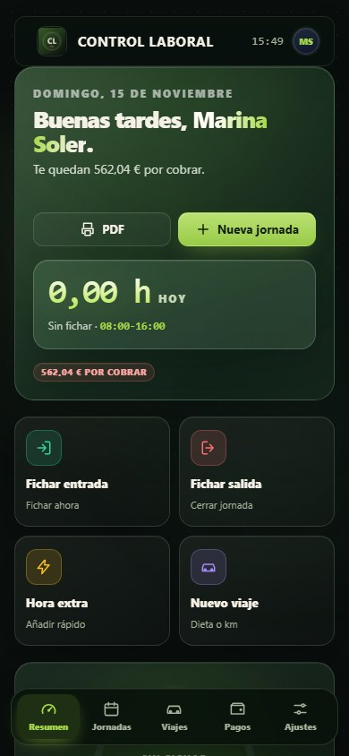

<div align="center">
  
  <h1>Control Laboral</h1>
  <p><strong>El registro de tu jornada y el seguimiento de tus cobros, en una sola aplicación.</strong></p>
  <p>Creado por <strong>工V龱尺ㄚ㇌7</strong></p>
  <p>
    <a href="https://ivory37goku.github.io/ivory37-control-laboral/">Abrir la aplicación</a>
    · <a href="#instalacion">Instalación</a>
    · <a href="#capturas">Capturas</a>
    · <a href="CHANGELOG.md">Historial de cambios</a>
  </p>
  <p>
    
    
    
    
  </p>
</div>

<p align="center">
  
</p>

Control Laboral permite registrar entradas y salidas, revisar horas normales y extra, organizar nóminas y anotar dietas y desplazamientos. Su panel **Aurora** presenta la actividad y los importes de cada mes para comparar el trabajo registrado con el dinero recibido.

La aplicación guarda los datos en el dispositivo. La sincronización opcional permite compartirlos entre Android, Windows y la web al iniciar sesión con la misma cuenta.

**Código documentado · 3.3.13** &nbsp; | &nbsp; **Autor · 工V龱尺ㄚ㇌7** &nbsp; | &nbsp; **Cuenta del proyecto · Ivory37goku**

## Contenido

- [Funciones](#funciones)
- [Capturas y demostración](#capturas)
- [Instalación y actualizaciones](#instalacion)
- [Primeros pasos](#primeros-pasos)
- [Cómo interpretar las horas y los importes](#horas-e-importes)
- [Datos, copias y sincronización](#datos)
- [Desarrollo y compilación](#desarrollo)
- [Documentación y soporte](#documentacion)
- [Créditos y licencia](#creditos)

<a id="funciones"></a>
## Funciones

| Área | Herramientas disponibles |
| --- | --- |
| **Panel Aurora** | Jornada de hoy, fichaje desde la cabecera, indicadores de cobro, actividad semanal y flujo de caja mensual. |
| **Jornadas** | Entrada y salida, registro manual, turnos nocturnos, pausas no computables, filtros y confirmación de jornadas provisionales. |
| **Horas extra** | Horas confirmadas por mes, valor según tarifa histórica, pago real anotado, importe medio recibido por hora y diferencia. |
| **Nóminas** | Propuestas mensuales calculadas a partir de las jornadas, edición de importes y confirmación de cobros. |
| **Viajes y dietas** | Concepto, fecha, importe y seguimiento de los desplazamientos pendientes o cobrados. |
| **Calendario** | Anotaciones de descansos, vacaciones, bajas, festivos y otras incidencias. |
| **Informes** | Consulta por período, exportación CSV e impresión o guardado en PDF. |
| **Copias y recuperación** | Exportación e importación JSON y recuperación de la copia interna disponible. |
| **Sincronización** | Cuenta opcional para compartir registros entre instalaciones y revisar cambios incompatibles. |
| **Personalización** | Perfil, imagen, logotipo, color, horario habitual y tarifas. |

<a id="capturas"></a>
## Capturas y demostración

Todas las imágenes muestran **la aplicación con datos ficticios** del perfil «Marina Soler». Incluyen jornadas, nóminas, viajes e incidencias de ejemplo. La captura de Windows se tomó dentro de la aplicación de escritorio; las vistas móviles muestran la interfaz adaptada al tamaño de un teléfono.

### Aurora en móvil

<table>
  <tr>
    <th align="center">Jornada de hoy y accesos</th>
    <th align="center">Flujo de caja por mes</th>
  </tr>
  <tr>
    <td align="center"></td>
    <td align="center"></td>
  </tr>
</table>

El flujo de caja presenta los últimos ocho meses con actividad. Las horas extra de un mes siguen visibles cuando su pendiente de cobro llega a cero.

### Comparativa mensual de horas extra

<p align="center">
  
</p>

En el ejemplo de noviembre, **9,00 h** a **19,69 €/h** tienen un valor de **177,21 €**. Al anotar **120,00 €** recibidos, la comparación muestra **13,33 €/h** de media y **57,21 €** de diferencia con el valor esperado.

<details>
  <summary><strong>Jornadas y calendario</strong></summary>
  <p>Registro con fechas, horarios, horas normales, extras y estado de confirmación. El calendario incluye incidencias ficticias.</p>
  
</details>

<details>
  <summary><strong>Nóminas y pagos de horas extra</strong></summary>
  <p>Nóminas confirmadas y pendientes, junto con el desglose de extras del perfil ficticio.</p>
  
</details>

<details>
  <summary><strong>Viajes y dietas</strong></summary>
  <p>Desplazamientos de ejemplo con sus importes y estados de cobro.</p>
  
</details>

<details>
  <summary><strong>Perfil y ajustes</strong></summary>
  <p>Configuración del perfil y acceso a las opciones de la aplicación.</p>
  
</details>

<a id="instalacion"></a>
## Instalación y actualizaciones

### Android

Instala la **APK** de la entrega que vayas a utilizar. Android puede solicitar autorización para instalarla desde el navegador o el gestor de archivos.

Para actualizar, instala la APK nueva sobre la aplicación existente **con la misma firma**. La interfaz está incluida en el paquete y puede abrirse sin conexión. La actualización del diseño y de las funciones requiere una APK nueva.

Requisitos y compilación en la [guía de Android](android-app/README.md).

### Windows

Ejecuta **Control Laboral Setup … .exe** y sigue el asistente. El instalador permite elegir la ubicación y crear accesos directos.

Para actualizar, ejecuta el Setup nuevo sobre la instalación existente. Windows conserva el perfil en `%APPDATA%\IVORY37 Control Laboral`. La aplicación incluye sus archivos y puede arrancar sin conexión.

Instrucciones en la [guía de Windows](desktop/README.md).

### Web y PWA

Abre [Control Laboral en el navegador](https://ivory37goku.github.io/ivory37-control-laboral/). En un navegador compatible, usa **Instalar app**. En iPhone o iPad, utiliza **Compartir → Añadir a pantalla de inicio**.

Después de la primera carga, la PWA dispone de caché para abrir sin conexión. Si detecta una versión posterior, ofrece un aviso para aplicarla.

> La versión de la web depende de la entrega publicada. Las instrucciones para generar APK y EXE están en [Desarrollo](#desarrollo).

<a id="primeros-pasos"></a>
## Primeros pasos

1. **Configura tu perfil.** Indica tu nombre y, si quieres, una imagen o un logotipo desde Ajustes.
2. **Revisa el horario y las tarifas.** Establece las horas normales diarias, el precio de cada hora y la pausa no computable.
3. **Registra tu jornada.** Ficha desde el panel o añade el turno manualmente. En el formulario puedes calcular las horas a partir de la entrada, la salida y la pausa.
4. **Revisa los cobros.** Confirma las nóminas recibidas y marca las extras y los viajes cobrados.
5. **Compara el pago de extras.** Anota el total recibido por mes para contrastarlo con las horas y las tarifas registradas.
6. **Guarda una copia.** Exporta un JSON desde **Ajustes → Datos y copias**. Si deseas sincronizar dispositivos, inicia sesión con la misma cuenta en cada instalación.

<a id="horas-e-importes"></a>
## Cómo interpretar las horas y los importes

| Concepto | Qué representa |
| --- | --- |
| **Jornada confirmada** | Registro incluido en los cálculos de horas e importes correspondientes. |
| **Jornada provisional** | Registro pendiente de confirmar, excluido de los cálculos que requieren confirmación. |
| **Pausa no computable** | Minutos descontados al calcular las horas desde el fichaje. |
| **Valor de extras** | Horas extra confirmadas valoradas con la tarifa aplicable a la fecha de cada jornada. |
| **Recibido real** | Importe que anotas para comparar el pago de las extras del mes. |
| **Recibido por hora** | Pago real anotado dividido entre todas las horas extra confirmadas del mes. |
| **Pendiente de cobro** | Importe calculado según los estados de nóminas, extras y viajes. |

Anotar el pago real en la comparativa mensual sirve para revisar la diferencia con la tarifa. Para actualizar el pendiente, utiliza también las marcas de cobro de las jornadas y los pagos.

Las incidencias del calendario se guardan como anotaciones. Las nóminas propuestas se calculan a partir de las jornadas y tarifas de la aplicación. Los registros confirmados o editados a mano conservan sus importes.

<a id="datos"></a>
## Datos, copias y sincronización

**Guardado local.** Cada instalación mantiene sus registros en el dispositivo. El inicio de sesión activa la sincronización opcional mediante Supabase.

**Trabajo sin conexión.** Puedes trabajar con los archivos instalados o la caché disponible. La autenticación y el intercambio de datos entre dispositivos requieren conexión.

**Cambios entre dispositivos.** Las versiones incompatibles pueden requerir revisión. Si un registro cambia mientras editas su formulario, la aplicación comprueba los campos al guardar y avisa cuando necesita que revises la última versión.

**Copias de seguridad.** Exporta JSON periódicamente y antes de cambiar de dispositivo. La copia interna disponible permite recuperar un estado anterior. Borrar el almacenamiento del navegador o desinstalar la aplicación puede eliminar los datos locales.

**Pagos históricos.** Cuando existen varios pagos confirmados o editados manualmente para un mismo mes, se conservan para que puedas revisar su contenido.

<a id="desarrollo"></a>
## Desarrollo y compilación

La interfaz está escrita en HTML, CSS y JavaScript. Android utiliza WebView y Windows utiliza Electron. La sincronización opcional se apoya en Supabase.

### Preparar el proyecto

Desde la raíz del repositorio, con Node.js y npm instalados, ejecuta lo siguiente. La comprobación de GitHub Actions utiliza Node.js 22.

```bash
npm ci
npm run check
```

### Ejecutar la web local

Con Python instalado, inicia el servidor y abre `http://localhost:8080`.

```bash
python -m http.server 8080
```

### Ejecutar y empaquetar Windows

Ejecuta la aplicación en desarrollo con este comando.

```bash
npm start
```

Genera el instalador desde Windows.

```powershell
npm run dist:win:setup
```

El Setup queda en `desktop-dist/`.

### Compilar Android

El proyecto utiliza JDK 17 y Android SDK Platform 36. En PowerShell, desde la raíz, ejecuta lo siguiente.

```powershell
cd android-app
.\gradlew.bat assembleDebug
```

El resultado queda en `android-app/app/build/outputs/apk/debug/app-debug.apk`. Conserva la clave de firma para preparar actualizaciones compatibles con la instalación anterior.

### Comprobaciones

`npm run check` valida la sintaxis y ejecuta las pruebas de horas, tarifas, calendario, copias, exportación, sincronización simulada y regresiones de guardado y nóminas.

La revisión visual y las pruebas de instalación se describen en la [guía de calidad](docs/QUALITY-CHECKLIST.md). Las capturas ilustran el uso de la aplicación con datos ficticios.

### Organización del código

| Ruta | Responsabilidad |
| --- | --- |
| `index.html` | Interfaz, componentes y estilos. |
| `app.js` | Jornadas, panel, pagos y ajustes. |
| `work-hours.js`, `rates.js`, `overtime-tools.js` | Duración de turnos, tarifas y resumen de extras. |
| `calendar.js`, `reports.js`, `backup-tools.js` | Calendario, informes y copias. |
| `theme-tools.js` | Personalización de color. |
| `supabase-sync.js`, `supabase/` | Sincronización y configuración de la base de datos. |
| `pwa.js`, `sw.js` | Instalación, caché y actualización de la PWA. |
| `android-app/`, `desktop/` | Aplicaciones Android y Windows. |
| `tests/`, `docs/` | Pruebas, documentación y capturas. |

<a id="documentacion"></a>
## Documentación y soporte

- [Historial de versiones y cambios](CHANGELOG.md)
- [Compilación y uso en Android](android-app/README.md)
- [Compilación y uso en Windows](desktop/README.md)
- [Configuración de Supabase](supabase/README.md)
- [Auditoría y comprobaciones de calidad](docs/QUALITY-CHECKLIST.md)
- [Comunicar un fallo en GitHub](https://github.com/Ivory37goku/ivory37-control-laboral/issues)

Para comunicar un fallo, indica la versión de Control Laboral, la plataforma y los pasos necesarios para reproducirlo. Utiliza ejemplos ficticios u oculta los datos personales de las capturas.

<a id="creditos"></a>
## Créditos y licencia

**Creador de Control Laboral · 工V龱尺ㄚ㇌7**

Cuenta del proyecto en GitHub · [Ivory37goku](https://github.com/Ivory37goku).

Distribuido bajo la [licencia MIT](LICENSE), con la atribución de copyright de Ivory37goku. Electron, Supabase y los demás componentes de terceros conservan sus licencias correspondientes.

<p align="center">
  <strong>Control Laboral</strong><br>
  Creado por <strong>工V龱尺ㄚ㇌7</strong>
</p>
