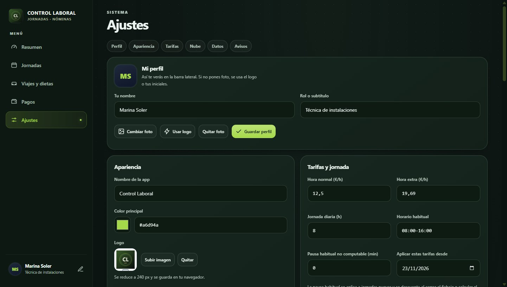

<p align="center">
  
</p>

<h1 align="center">Control Laboral</h1>

<p align="center">
  <strong>Gestión integral de jornadas, horas extra, nóminas, dietas y calendario laboral.</strong><br>
  Disponible como PWA sin conexión, aplicación Android nativa y ejecutable de escritorio para Windows.
</p>

<p align="center">
  <a href="https://ivory37goku.github.io/ivory37-control-laboral/"><strong>Abrir en el Navegador</strong></a>
  ·
  <a href="CHANGELOG.md">Historial de versiones</a>
  ·
  <a href="docs/QUALITY-CHECKLIST.md">Auditoría y pruebas</a>
</p>

<p align="center">
  
  
  
  
  
</p>

---

## 📸 Capturas de Pantalla

### Panel de Control y Aplicación de Escritorio
<p align="center">
  
</p>
<p align="center"><em>Panel principal: resumen semanal, balance de nómina, fichaje en vivo y comparativa mensual.</em></p>

---

### Experiencia Móvil (Android y PWA)
<p align="center">
  
  &nbsp;&nbsp;&nbsp;&nbsp;
  
</p>
<p align="center"><em>Diseño adaptativo para móvil: botones táctiles de fichaje rápido y desglose de cobros.</em></p>

---

### Jornadas y Comparativa de Horas Extra
<p align="center">
  
</p>
<p align="center"><em>Registro de jornadas, horas ordinarias y extraordinarias, pausas no computables y turnos nocturnos.</em></p>

<p align="center">
  
</p>
<p align="center"><em>Comparativa de tarifas históricas frente a pagos recibidos reales.</em></p>

---

### Configuración, Identidad y Sincronización
<p align="center">
  
</p>
<p align="center"><em>Personalización de perfil, colores de marca, tarifas horarias históricas y sincronización en la nube.</em></p>

> Las capturas emplean datos de prueba ilustrativos sin información de usuarios reales.

---

## ✨ Características Principales

* ⏱️ **Registro de Jornada y Fichaje:** Registro de entrada y salida en un clic, cálculo automático de horas netas descontando pausas no computables y soporte para turnos que cruzan la medianoche.
* 💰 **Control de Nóminas y Horas Extra:** Seguimiento automático de importes acumulados según tarifas horarias vigentes, desglose de horas extra pendientes y confirmadas, y control de cobros reales.
* 🚗 **Viajes y Dietas:** Gestión de gastos de kilometraje, desplazamientos y dietas con control de estado de liquidación.
* 📅 **Calendario Laboral e Incidencias:** Anotación de descansos, vacaciones, bajas médicas y festivos oficiales sin alterar jornadas ya registradas.
* 📊 **Informes y Exportación Segura:** Exportación de informes en formato PDF imprimible y CSV con protección nativa contra inyecciones de fórmulas.
* 🔄 **Sincronización Multiplataforma:** Sincronización en la nube opcional con Supabase protegida por políticas de aislamiento Row Level Security (RLS) por usuario y resolución inteligente de conflictos.
* 💾 **Almacenamiento Local First:** La aplicación funciona al 100% sin conexión a internet. Los datos residen en tu propio dispositivo.

---

## 🛡️ Arquitectura y Blindaje de Seguridad

El proyecto implementa un estándar estricto de seguridad técnica:

1. **Content Security Policy (CSP) Estricta:** Implementada en `index.html` para bloquear la ejecución de scripts no autorizados y prevenir la exfiltración de datos o tokens de sesión hacia servidores externos.
2. **Protección de Base de Datos y Anti-DoS:** Las tablas de sincronización en Supabase cuentan con políticas RLS de usuario estricto (`auth.uid() = user_id`) y restricciones de tamaño en base de datos (`check_payload_size`) que impiden ataques por saturación de almacenamiento.
3. **Aislamiento en Electron (Desktop):** Configurado con `contextIsolation: true`, `sandbox: true`, `nodeIntegration: false`, deshabilitación de contenido inseguro y filtrado exhaustivo de navegación externa.
4. **Protección contra MitM en Android:** Configuración `network_security_config.xml` que exige certificados de autoridades raíz del sistema (`system`) y bloquea CAs instaladas por el usuario o proxies de interceptación.
5. **Sanitización de Salidas y CSV:** Escape de caracteres con `esc()` en todas las vistas dinámicas y sanitización de caracteres de control (`=`, `+`, `-`, `@`) en celdas de exportación CSV para evitar ejecución de comandos en hojas de cálculo.

---

## 📦 Plataformas Soportadas

| Plataforma | Tipo | Estado | Modo de uso |
| :--- | :--- | :--- | :--- |
| **Web & PWA** | Aplicación Web Progresiva | Lista | [Abrir en navegador](https://ivory37goku.github.io/ivory37-control-laboral/) / Instalar desde el navegador |
| **Windows** | Instalador Setup (.exe) | Listo | Empaquetado con Electron (`desktop-dist/Control Laboral Setup 3.3.12.exe`) |
| **Android** | Paquete APK (.apk) | Listo | Compilado con WebViewAssetLoader local (`android-app/app/build/outputs/apk/debug/app-debug.apk`) |

---

## 🚀 Desarrollo y Compilación

### Requisitos previos
* **Node.js:** Versión 22 o superior
* **Java JDK:** Versión 17 (para compilación Android)
* **Android SDK:** Platform 34+ y Build Tools

### Servidor de desarrollo web
```bash
# Servir en local sin pasos de compilación previos
python -m http.server 8080
```
Abre en tu navegador: `http://localhost:8080`

### Ejecución de comprobaciones y suite de pruebas
```bash
# Ejecutar comprobaciones de sintaxis y suite de 66 pruebas automatizadas
npm run check
```

### Compilar instalador para Windows
```bash
npm install
npm run dist:win:setup
```
El instalador ejecutable generado se guardará en `desktop-dist/`.

### Compilar APK para Android
```bash
cd android-app
./gradlew assembleDebug
```
La APK lista para instalar se generará en `app/build/outputs/apk/debug/app-debug.apk`.

---

## 📄 Licencia

Este proyecto está bajo la licencia [MIT](LICENSE).
