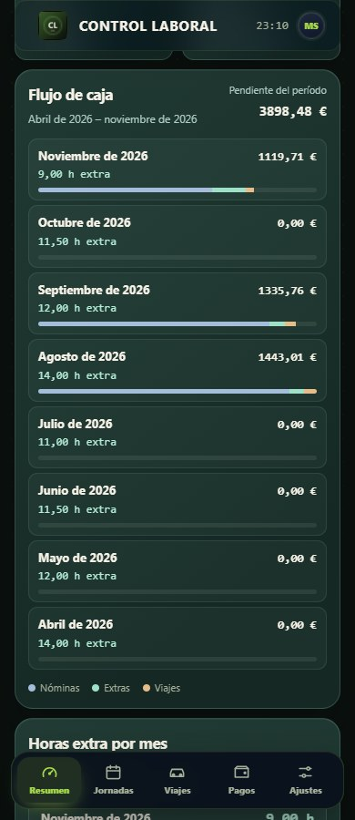

<p align="center">
  
</p>

<h1 align="center">Control Laboral</h1>

<p align="center">
  Registra jornadas, consulta horas y controla lo que tienes pendiente de cobrar.
</p>

<p align="center">
  <a href="https://ivory37goku.github.io/ivory37-control-laboral/"><strong>Abrir la aplicación</strong></a>
  ·
  <a href="android-app/README.md">Compilar para Android</a>
</p>

<p align="center">
  <a href="CHANGELOG.md">Historial de versiones</a>
  ·
  <a href="docs/QUALITY-CHECKLIST.md">Auditoría y pruebas</a>
</p>

<p align="center">
  
  
</p>

Control Laboral es una aplicación personal para anotar horas trabajadas, revisar nóminas y organizar viajes y ausencias. Funciona como web instalable, aplicación Android y aplicación de escritorio para Windows, con una interfaz adaptada a móvil y ordenador.

## Capturas

<p align="center">
  
</p>
<p align="center"><em>Panel Aurora con el fichaje, los cobros y las horas extra a la vista.</em></p>

<p align="center">
  
  
</p>
<p align="center"><em>Accesos de fichaje y flujo de caja por mes en el móvil.</em></p>

<p align="center">
  
</p>
<p align="center"><em>Comparativa de lo que corresponde por tarifa y el pago real de las horas extra.</em></p>

<p align="center">
  
</p>
<p align="center"><em>Registro de jornadas, horas extra e incidencias</em></p>

<p align="center">
  
</p>
<p align="center"><em>Perfil, marca, tarifas, copias y sincronización</em></p>

> Las capturas usan datos de demostración ficticios. No contienen información de una cuenta real.

## Funciones

- **Panel:** fichaje de hoy, cobros y horas de la semana. El flujo de caja muestra los últimos ocho meses con actividad, con horas extra aunque el pendiente sea 0 €. En la comparativa puedes anotar el pago real y ver la diferencia y el importe recibido por hora extra confirmada.
- **Jornadas:** fichaje de entrada y salida, registro manual, turnos nocturnos, pausa no computable configurable, horas extra, filtros y confirmación de jornadas provisionales.
- **Pagos y viajes:** seguimiento de nóminas, dietas y desplazamientos, con estado de pago.
- **Calendario:** registro de descansos, vacaciones, bajas, festivos y otras incidencias.
- **Informes:** consulta por fechas, impresión o guardado en PDF y exportación a CSV.
- **Copias y datos:** backup JSON, restauración, copia local automática y sincronización opcional entre dispositivos.
- **Personalización:** perfil, foto y logotipo propios, además de la identidad visual de Control Laboral.
- **PWA:** aplicación instalable y disponible sin conexión después de la primera carga. Cuando hay una nueva versión, puedes aplicarla desde el aviso de actualización.

## Formas de uso

| Plataforma | Cómo abrirla |
| --- | --- |
| Web y PWA | [Abrir Control Laboral](https://ivory37goku.github.io/ivory37-control-laboral/). En Android usa **Instalar app**; en iPhone o iPad, **Compartir → Añadir a pantalla de inicio**. |
| Android | La APK incluye la app y arranca sin conexión. Para actualizar, instala una APK nueva con la misma firma encima de la anterior. Consulta la [guía de compilación](android-app/README.md). |
| Windows | El instalador Setup incluye la app, abre sin conexión y recupera la copia local de instalaciones anteriores. Para generarlo, sigue los comandos de [Desarrollo](#desarrollo). |
| Desarrollo local | Sirve la carpeta por HTTP siguiendo las instrucciones de abajo. |

## Primeros pasos

1. Abre la app y entra en **Ajustes → Mi perfil** para indicar tu nombre y, si quieres, una foto o un logo.
2. Revisa **Ajustes → Tarifas y jornada** y configura el precio por hora y tu horario habitual.
3. Registra una jornada con **Nueva jornada** o usa los botones de fichaje.
4. Confirma las jornadas provisionales para incluirlas en los importes correspondientes.
5. Descarga un backup desde **Ajustes → Datos y copias**. Para sincronizar la PWA, APK y EXE, inicia sesión con la misma cuenta en cada instalación.

## Desarrollo

### Ejecutar la versión web

No se necesita compilar la versión web. Desde la raíz del repositorio, inicia un servidor local:

```bash
python -m http.server 8080
```

Abre <http://localhost:8080>. En desarrollo, el service worker y la caché sin conexión funcionan en `localhost`; la versión publicada usa HTTPS en GitHub Pages.

### Aplicación de Windows

Se requiere Node.js y npm. Instala las dependencias, ejecuta las comprobaciones y genera el instalador de Windows:

```bash
npm install
npm run check
npm run dist:win:setup
```

El instalador se guarda en `desktop-dist/`. Para iniciar la app durante el desarrollo, usa `npm start`.

### Aplicación Android

Abre `android-app/` en Android Studio, sincroniza Gradle y genera la APK desde **Build → Build Bundle(s) / APK(s) → Build APK(s)**. Los requisitos y la alternativa de línea de comandos están en [`android-app/README.md`](android-app/README.md).

## Datos y privacidad

Los cambios se guardan primero en el dispositivo. Si inicias sesión en **Ajustes → Nube**, los datos de jornadas, viajes, pagos y ajustes también se sincronizan con Supabase para compartirlos entre instalaciones. El inicio de sesión y la sincronización requieren conexión; la interfaz puede seguir funcionando sin conexión después de cargar la app.

Sin una cuenta, los datos permanecen en el dispositivo. Descarga backups JSON con regularidad: borrar el almacenamiento del navegador o reinstalar una aplicación puede eliminar la copia local.

## Tecnologías

- HTML, CSS y JavaScript sin framework para la interfaz.
- PWA con manifest y service worker.
- Supabase opcional para autenticación y sincronización; SDK incluido en `vendor/`.
- Electron para Windows y Android WebView para la APK.

## Estructura del proyecto

```text
index.html         Interfaz, diseño y componentes de la app
app.js             Lógica de jornadas, dashboard, pagos y ajustes
rates.js           Tarifas históricas
calendar.js        Calendario de ausencias e incidencias
reports.js         Informes y exportación CSV
pwa.js, sw.js      Instalación, caché y actualizaciones PWA
supabase/          Esquema y políticas de la base de datos
android-app/       Proyecto Android y guía de compilación
desktop/           Aplicación Electron para Windows
docs/              Capturas de la documentación
```

## Licencia

Este proyecto se distribuye bajo la licencia [MIT](LICENSE).
