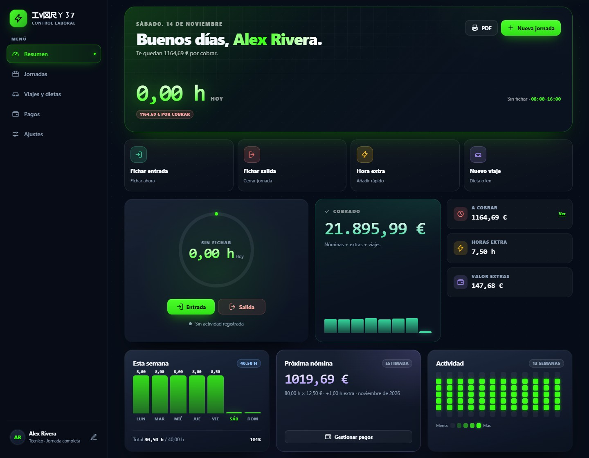
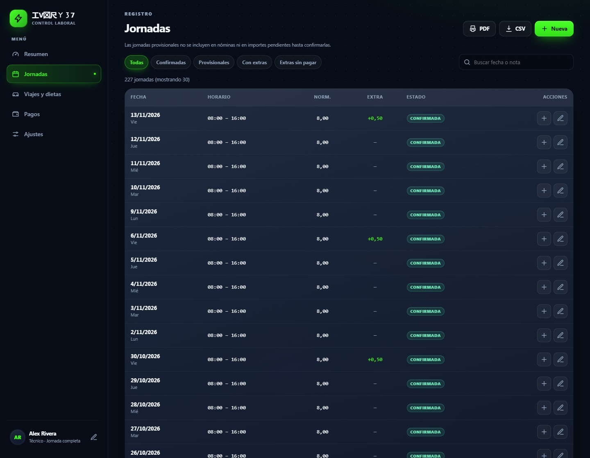
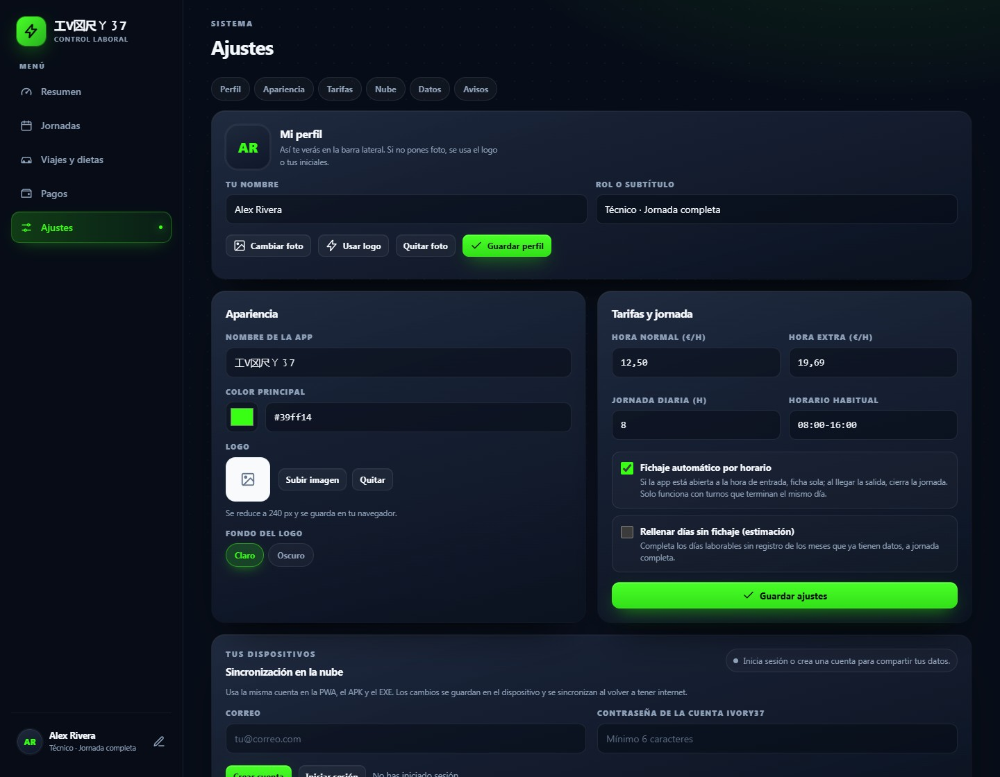
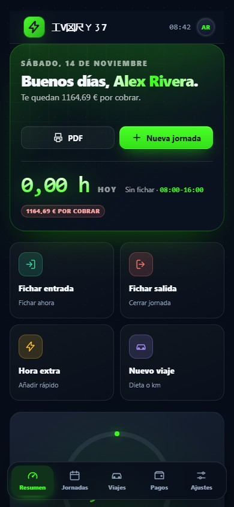
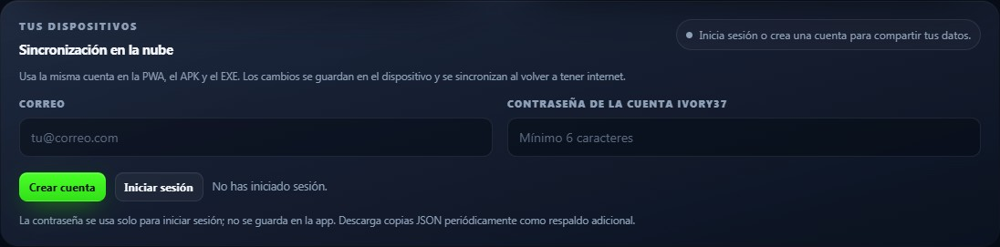

# IVORY37 · Control laboral 🥋

> **Panel personal de jornadas, horas extra, viajes y nóminas.**
> Una aplicación web de una sola página para saber qué has trabajado, qué te deben y qué
> has cobrado. Conserva los datos en el dispositivo y puede sincronizarlos con tu cuenta.

👉 **Demo:** https://ivory37goku.github.io/ivory37-control-laboral/


---

## ✨ Características

### 📊 Panel

- Cuatro indicadores: **Cobrado, A cobrar, Horas extra y Valor extras**.
- **A cobrar** suma nóminas automáticas aún sin confirmar, extras confirmadas sin pagar
  y viajes pendientes. Las horas provisionales se excluyen hasta confirmarlas.
- **Flujo de caja (pend.)**: barras mensuales de horas extra con eje, total y aviso de
  los viajes pendientes.
- Desglose de lo pendiente y saludo personalizado.

### ⏱️ Fichaje y jornadas

- Entrada/salida con cálculo real de horas, incluidos turnos nocturnos.
- **Fichaje automático** por horario, botón «Según horario» y «Completar mes».
- Edición, borrado, filtros, búsqueda, paginación y confirmación masiva.
- Horas extra por jornada con control de pago independiente.

### 💰 Nóminas y pagos

- Nóminas mensuales automáticas, confirmación y edición.
- Viajes y dietas con estado cobrado/pendiente.
- Informe imprimible (**Guardar como PDF** del navegador) con logo y cabecera de perfil.

### 🎨 Personalización y datos

- **Perfil**: nombre, rol y foto o logo en la barra lateral y en móvil.
- **Logo de la app** con fondo claro/oscuro y adaptación a logos apaisados; favicon
  dinámico.
- Backup JSON, exportación CSV segura frente a fórmulas, restauración transaccional y
  aviso de la última copia.
- Guardado local y sincronización entre pestañas.
- Sincronización opcional entre PWA, APK y EXE con la misma cuenta IVORY37.
- **PWA instalable y offline** en GitHub Pages: manifest, iconos válidos, actualización
  controlada y copia en caché de la aplicación.

## 📸 Capturas

<p align="center">
  
</p>
<p align="center"><em>Panel principal · datos de ejemplo</em></p>

<p align="center">
  
  
</p>
<p align="center"><em>Jornadas y ajustes</em></p>

<p align="center">
  
</p>
<p align="center"><em>Vista móvil</em></p>

<p align="center"></p>
<p align="center"><em>Cuenta y sincronización entre dispositivos</em></p>

<p align="center"><em>Datos de ejemplo. Solo se sincronizan con Supabase si inicias sesión.</em></p>

---

## 🛠️ Tecnologías

- **HTML5 + JavaScript vanilla**, sin frameworks ni build.
- **CSS propio**, iconos SVG inline y gráficas SVG/CSS.
- SDK de Supabase incluido localmente; la app no carga librerías desde CDN.
- Informe mediante la impresión del navegador (sin jsPDF).
- **localStorage** para el guardado inmediato. Al iniciar sesión, Supabase sincroniza los
  datos de la cuenta; el service worker guarda la interfaz para abrirla sin conexión.

---

## 🚀 Cómo empezar

### PWA en GitHub Pages

Abre https://ivory37goku.github.io/ivory37-control-laboral/ desde Chrome/Edge en Android
(o Safari en iPhone/iPad). En Android usa el botón **Instalar app** o el menú del navegador;
en iOS usa **Compartir → Añadir a pantalla de inicio**. La app se puede abrir sin conexión
tras su primera carga.

GitHub Pages ya sirve el repositorio; al publicar los cambios en `main`, sus archivos de
raíz (`index.html`, `manifest.json`, `sw.js` e iconos) se actualizan allí automáticamente.

### APK para Android

El proyecto Android está en [`android-app/`](android-app/). La APK 3.2.1 incluye la interfaz y
el SDK dentro de Android WebView, sin abrir Chrome. La conexión solo se necesita para
sincronizar. En Android Studio abre esa carpeta y compila **Build → Build Bundle(s) / APK(s) →
Build APK(s)**; los pasos completos y el comando `gradlew.bat assembleDebug` están en
`android-app/README.md`.

### Uso directo

Abre `index.html` para usarla en el ordenador. La instalación PWA y el modo offline del
service worker requieren la dirección HTTPS de GitHub Pages (o un servidor local).

Para probarla por HTTP local:

```bash
python3 -m http.server 8080
# http://localhost:8080
```

### Clonar

```bash
git clone https://github.com/Ivory37goku/ivory37-control-laboral.git
cd ivory37-control-laboral
```

> La antigua demo `/ki-control/` corresponde a una **versión anterior**. La versión
> actual está en https://ivory37goku.github.io/ivory37-control-laboral/ y en este
> repositorio (`index.html`).

### Primeros pasos

1. Abre **Ajustes → Mi perfil** y pon tu nombre.
2. Revisa **Tarifas y jornada** (precio/hora, jornada diaria y horario).
3. Para compartir datos entre instalaciones, crea una cuenta en **Ajustes → Nube** y usa
   la misma cuenta en la PWA, APK y EXE. Confirma el correo si Supabase te lo solicita.
4. Si vienes de la versión anterior, entra en **Ajustes → Restaurar** e importa tu
   backup JSON. Se migran el logo y el nombre antiguos.

---

## 🔒 Privacidad

La app guarda cada cambio primero en el almacenamiento local. Si inicias sesión en
**Ajustes → Nube**, también envía jornadas, viajes, pagos y ajustes a Supabase para
sincronizarlos entre dispositivos. Las políticas RLS de la tabla limitan cada cuenta a sus
propios datos. El inicio de sesión y la sincronización requieren internet; el resto de la app
puede seguir funcionando sin conexión.

> **Aviso:** mantén una copia JSON periódica. Si no has iniciado sesión, borrar los datos
> del sitio o reinstalar una aplicación puede eliminar la única copia de ese dispositivo.

---

## 📁 Estructura

```
index.html     Aplicación web (HTML + CSS + JS)
supabase/      Esquema de base de datos y políticas de acceso
vendor/        SDK de Supabase incluido localmente y su licencia
android-app/   Proyecto Android WebView y guía para compilar APK
docs/          Capturas para el README
README.md      Este archivo
CHANGELOG.md   Historial de versiones
MEJORAS.md     Revisión técnica y siguientes pasos
LICENSE        Licencia MIT
```

---

## 🤝 Contribuir

1. Haz un fork del proyecto.
2. Crea una rama: `git checkout -b feature/mi-mejora`.
3. Commit: `git commit -m 'Añade mi mejora'`.
4. Push: `git push origin feature/mi-mejora`.
5. Abre un Pull Request.

---

## 📄 Licencia

Distribuido bajo la licencia **MIT**. Consulta [LICENSE](LICENSE).

---

## 👨‍💻 Autor

**工V龱尺ㄚ㇌7**

> «El control laboral no debería ser complicado. Debería ser elegante.»
