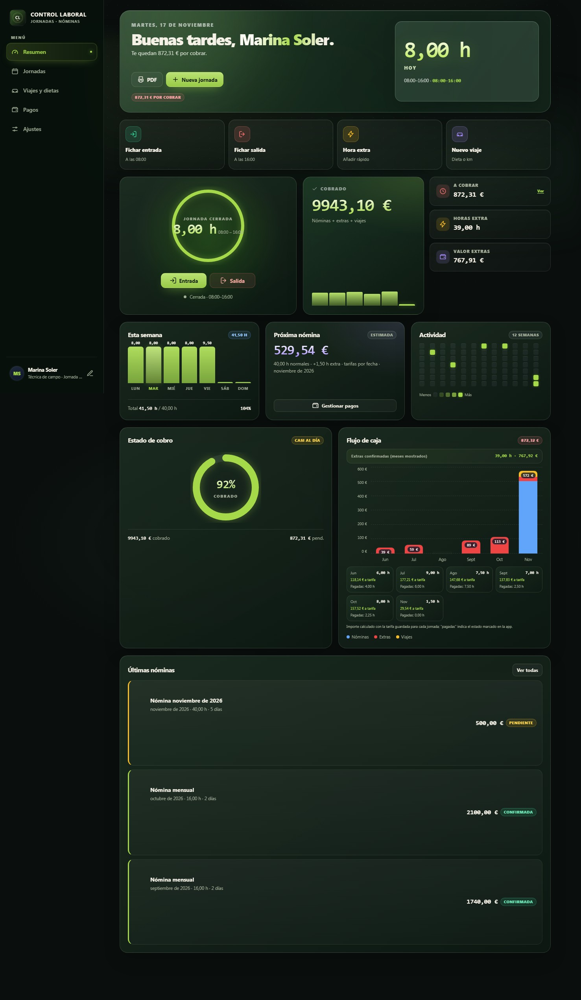
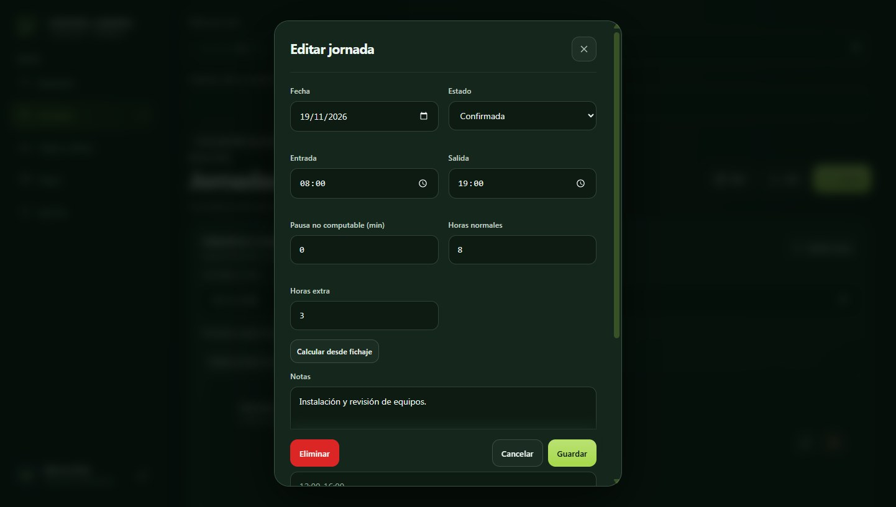

# Aurora · Control Laboral 3.3.21

23 de noviembre de 2026 · Creador: **工V龱尺ㄚ㇌7**

## Diseño aplicado a la app

- Acabado verde común para Resumen, Jornadas, Viajes, Pagos y Ajustes.
- Fichaje ordenado en móvil, con PDF junto al título y botones de entrada y registro sin columnas vacías heredadas.
- Horas extra mensuales y sus valores económicos con mayor jerarquía visual.
- Formularios con etiquetas más legibles, campos amplios y pie de guardar/cancelar visible al desplazarse.
- Listados, tablas, estados y navegación con bordes, espacios y tipografía coherentes.
- Foco de teclado visible, controles más amplios y respeto por la preferencia de movimiento reducido.

La presentación se concentra en `aurora-ui.css`, incluida en Android, Windows y el precaché de la PWA. Sus reglas solo se aplican a pantalla, conservando los estilos de impresión. No modifica cálculos, datos ni el protocolo de sincronización.

## Capturas reales con datos ficticios

Las capturas se generan con `scripts/capture-readme.cjs`, un perfil temporal y renderizado offscreen para capturar también los formularios sin depender del compositor de una ventana oculta. Los datos pertenecen al perfil ficticio Marina Soler.

## Recuperación gratuita verificada

El propietario autorizó una única solicitud a su correo. Se utilizó el botón real de recuperación de la app y el SDK incluido, desde un perfil temporal aislado. Se registró una petición POST; Supabase la aceptó y el propietario confirmó la llegada del mensaje a Proton.

Esto verifica solicitud y entrega. **No se cambió la contraseña ni se declara probado el cambio completo de contraseña de producción.** No se contrataron servicios ni se activó el plan Pro. La protección de Supabase contra contraseñas filtradas permanece desactivada por la condición de mantener el plan gratuito.

## Validación

- 85 pruebas automatizadas aprobadas.
- Recorrido Electron aprobado: fichaje, edición, confirmación de nómina, borrado y deshacer, cinco pestañas, copia/restauración y reinicio.
- Pruebas de migración, aborto de transacciones, concurrencia entre ventanas, 7 MB y PIN aprobadas.
- Revisión de distribución a 320, 390, 768 y 1440 píxeles, más capturas del panel, listados, ajustes y formulario.
- Compilaciones Android release/audit y Windows. La APK conserva la identidad y firma de actualización anteriores; versión 3.3.21, código 30.
- Recorrido Android 3.3.21 aprobado, incluido reinicio sin conexión. Recursos finales del APK y del ASAR de Windows comparados con los archivos fuente: coinciden.
- APK e instalador EXE entregados en Descargas. No se genera portable.
- Al integrar los cambios remotos de `main`, se conserva la configuración nativa de seguridad de red y se amplía la comprobación de CSP. La suite integrada queda en **86 pruebas aprobadas**; los recorridos de Electron y fiabilidad también se repiten con éxito.

La seguridad no se presenta como absoluta. Los límites del almacenamiento, PIN, avisos de Android y servicios externos están documentados en [Fiabilidad 3.3.20](RELIABILITY-3.3.20.md). Esta entrega no publica cambios en GitHub ni modifica la configuración productiva de Supabase.
